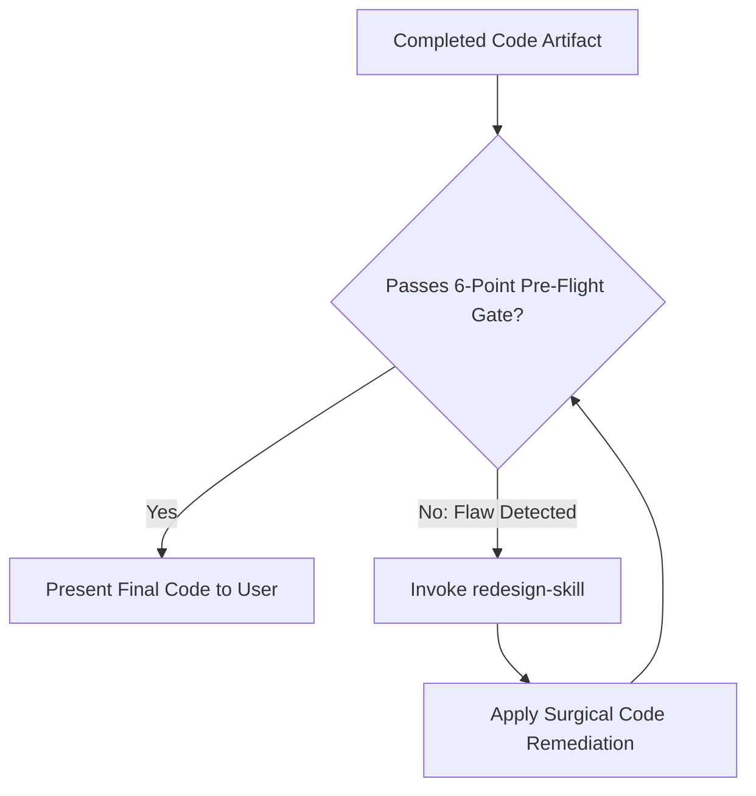

# Output-Skill: The Final Quality & Delivery Gate

## Overview
**Output-Skill** sits at the apex of the modular frontend and systems design stack. It functions as the **final, non-negotiable quality gatekeeper** before any code, component, refactoring, or audit report is delivered to the user.

Software engineering must never deliver half-baked or untested output. **Output-Skill evaluates the completed artifact against all preceding layers in the stack** (`taste-skill`, `web-interface-guidelines`, `gpt-taste`, `soft-skill`, `stitch-skill`, and `awesome-design-md`). If a defect, anti-pattern, or security flaw is discovered during final inspection, it **immediately routes the artifact back to `redesign-skill` for automatic remediation** before presenting the work.

---

## Role in the Modular Stack
* **Stack Position**: **Layer 4 — Final Gatekeeper & Delivery Protocol (Skill #9)**
* **Inputs**: Completed code artifacts, page layouts, components, or audit reports.
* **Governing Layers**: Synthesizes the rules of all 8 preceding skills.
* **Feedback Mechanism**: Automatically invokes `redesign-skill` if pre-flight verification fails.

---

## 1. The Pre-Flight Quality Gate (6-Point Verification)

Before declaring any task complete or presenting code to the user, run this automated mental pre-flight verification:

### 1. Visual & Typographic Polish (`taste-skill`)
* [ ] Are all numeric counters, timers, financial figures, and metrics tagged with `tabular-nums`?
* [ ] Are three-dot ellipses `...` strictly replaced with the unicode character `…`?
* [ ] Are all keyboard shortcuts and units bound with non-breaking spaces (`⌘ K`, `10 MB`)?
* [ ] Is the 4px/8px mathematical spatial cadence strictly respected (`p-4`, `p-5`, `gap-6`)?
* [ ] Are headings formatted with `text-wrap: balance` or `text-pretty` to prevent lone widows?

### 2. Motion & Interaction Integrity (`web-interface-guidelines`)
* [ ] Is `transition: all` or `transition-all` 100% eliminated in favor of explicit properties (`transition-colors`, `transition-transform`)?
* [ ] Are animations compositor-friendly (`transform` and `opacity` only)?
* [ ] Are animations compliant with `prefers-reduced-motion`?
* [ ] Are interactive elements equipped with tactile active states (`active:scale-[0.98]`)?

### 3. Accessibility & Keyboard Ergonomics (`web-interface-guidelines`)
* [ ] Is naked `outline-none` eliminated and replaced with `:focus-visible` rings with offset?
* [ ] Do all interactive icon buttons have descriptive `aria-label` attributes?
* [ ] Do decorative icons include `aria-hidden="true"`?
* [ ] Do navigation actions use `<Link>` / `<a>` and mutation actions use `<button>`?

### 4. Code Architecture & Cleanliness (`gpt-taste`)
* [ ] Is the component under 200 lines, or cleanly decomposed into presentational sub-components?
* [ ] Are asynchronous states modeled as TypeScript Discriminated Unions rather than conflicting boolean flags?
* [ ] In Next.js App Router, is `'use client'` pushed strictly down to interactive leaf nodes?
* [ ] Are dynamic class conflicts cleanly resolved using `cn()` (`clsx` + `tailwind-merge`)?

### 5. UX Voice & Error Resilience (`soft-skill`)
* [ ] Are button labels explicit and outcome-driven (*"Save Changes"* over *"Submit"* or *"Continue"*)?
* [ ] Do error states follow the **3-Part Constructive Error Doctrine** (What + Why + Actionable Next Step)?
* [ ] Do empty states provide an orienting headline, reassuring explanation, and primary CTA?
* [ ] Are asynchronous mutation buttons equipped with inline spinners and disabled pointer events during execution?

### 6. Zero-Secret / Inspect Element Security Gate (`taste-skill`)
* [ ] Are all sensitive API keys, database credentials, and server secrets completely absent from client bundles and free of `NEXT_PUBLIC_*` prefixes?
* [ ] Are DOM attributes (`data-*`, hidden inputs) completely scrubbed of tokens, password hashes, or internal system traces?
* [ ] Are all debug `console.log` statements dumping credentials or tokens completely removed?
* [ ] Are authentication tokens handled securely via `HttpOnly` cookies rather than raw `localStorage`?

---

## 2. The Autonomous Redesign Loop (Self-Correction Protocol)

If **ANY** of the 6 pre-flight criteria fail during final evaluation:

1. **Do not deliver flawed code.**
2. Immediately invoke `redesign-skill` to perform the surgical correction:
   * Strip the naked `outline-none` and insert `focus-visible:ring-2`.
   * Replace `transition-all` with targeted `transition-colors`.
   * Inject `tabular-nums` onto dynamic numeric readouts.
   * Rewrite robotic error copy into the 3-part constructive format.
3. Re-evaluate against the 6-point checklist. Once green, proceed to delivery.

---

## 3. Delivery & Presentation Standards

When presenting completed code or architecture to the user:

### Direct, Senior Communication
* Avoid sycophantic pleasantries (*"I am happy to report...", "Here is the code you requested..."*).
* Lead immediately with the **Executive Summary of Changes**:
  * Architectural decisions made.
  * Security protections enforced.
  * Visual & interaction uplifts applied.
* Provide clickable GitHub markdown links to all modified files (`[file.tsx](file:///absolute/path/to/file.tsx)`).
* Use GitHub-flavored diff blocks showing the exact before-and-after transformations.
* Document any manual verification steps clearly and concisely.

