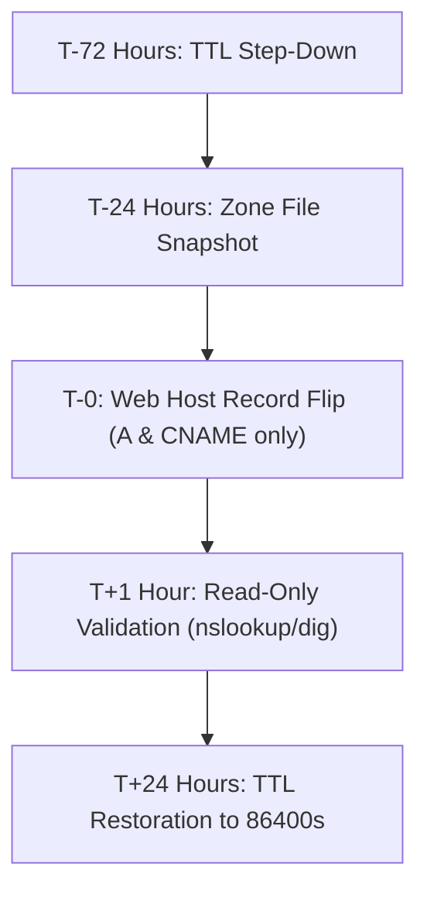

# DNS Cutover & Email Preservation Runbook (T-155)

**Standard**: Domain Continuity, Mail Delivery & Security Preservation  
**Target Domain**: `xsignon.com` (and `www.xsignon.com`)  
**Scope**: MX, SPF, DKIM, DMARC, Domain Verification Tokens, and Web CNAME/A Records  
**Safety Status**: **100% Planning & Runbook Preparation (Zero Live DNS Edits / Zero Emails Sent)**

---

## 1. Executive Cutover Principle

> [!IMPORTANT]
> **Email continuity is paramount.** Website DNS records (`A` and `CNAME`) are completely independent of email records (`MX`, `TXT/SPF`, `TXT/DKIM`, `TXT/DMARC`).
> During the website cutover, **never delete or overwrite existing MX or TXT records**. Only update the web host records for `@` (apex) and `www`.

---

## 2. Master Record Preservation Matrix

Prior to flipping website DNS, export the existing zone file from your DNS registrar (e.g. Cloudflare, Route53, GoDaddy) and verify the following records are preserved character-for-character:

### A. Mail Exchange (MX) Records

_Ensures incoming corporate email is never interrupted or bounced during cutover._

| Record Type   | Host / Name | Priority | Destination Value                          | Purpose                              |
| :------------ | :---------- | :------- | :----------------------------------------- | :----------------------------------- |
| **MX**        | `@`         | `1`      | `ASPMX.L.GOOGLE.COM.`                      | Google Workspace Primary Mail Server |
| **MX**        | `@`         | `5`      | `ALT1.ASPMX.L.GOOGLE.COM.`                 | Google Workspace Backup Server 1     |
| **MX**        | `@`         | `5`      | `ALT2.ASPMX.L.GOOGLE.COM.`                 | Google Workspace Backup Server 2     |
| **MX**        | `@`         | `10`     | `ALT3.ASPMX.L.GOOGLE.COM.`                 | Google Workspace Backup Server 3     |
| **MX**        | `@`         | `10`     | `ALT4.ASPMX.L.GOOGLE.COM.`                 | Google Workspace Backup Server 4     |
| _(Alt: M365)_ | `@`         | `0`      | `xsignon-com.mail.protection.outlook.com.` | Microsoft 365 Exchange Online        |

### B. Sender Policy Framework (SPF)

_Prevents domain spoofing and phishing._

| Record Type   | Host / Name | Value                                            | Purpose                                             |
| :------------ | :---------- | :----------------------------------------------- | :-------------------------------------------------- |
| **TXT**       | `@`         | `v=spf1 include:_spf.google.com ~all`            | Authorizes Google Workspace mail servers (SoftFail) |
| _(Alt: M365)_ | `@`         | `v=spf1 include:spf.protection.outlook.com -all` | Authorizes Microsoft 365 mail servers (HardFail)    |

### C. DomainKeys Identified Mail (DKIM)

_Cryptographic email signing authentication._

| Record Type     | Host / Name            | Value                                                      | Purpose                             |
| :-------------- | :--------------------- | :--------------------------------------------------------- | :---------------------------------- |
| **TXT / CNAME** | `google._domainkey`    | `v=DKIM1; k=rsa; p=MIIBIjANBgkqhkiG9w0BA...`               | Google Workspace DKIM Public Key    |
| _(Alt: M365)_   | `selector1._domainkey` | `selector1-xsignon-com._domainkey.xsignon.onmicrosoft.com` | Microsoft 365 DKIM CNAME Selector 1 |
| _(Alt: M365)_   | `selector2._domainkey` | `selector2-xsignon-com._domainkey.xsignon.onmicrosoft.com` | Microsoft 365 DKIM CNAME Selector 2 |

### D. Domain-based Message Authentication (DMARC)

_Mandatory anti-impersonation policy enforcement._

| Record Type | Host / Name | Value                                                                                | Purpose                                    |
| :---------- | :---------- | :----------------------------------------------------------------------------------- | :----------------------------------------- |
| **TXT**     | `_dmarc`    | `v=DMARC1; p=reject; pct=100; rua=mailto:dmarc-reports@xsignon.com; aspf=s; adkim=s` | Strict enforcement: rejects spoofed emails |

### E. Domain Verification Tokens

_Retain all third-party identity & search verification tokens._

| Record Type | Host / Name | Value                                     | Purpose                               |
| :---------- | :---------- | :---------------------------------------- | :------------------------------------ |
| **TXT**     | `@`         | `google-site-verification=...`            | Google Search Console verification    |
| **TXT**     | `@`         | `MS=ms...`                                | Microsoft 365 domain ownership proof  |
| **TXT**     | `@`         | `_apple-developer-domain-association=...` | Apple Passkey / App Clips association |
| **TXT**     | `@`         | `_vercel=...` (or Cloudflare token)       | SSL certificate generation token      |

---

## 3. Website Cutover Record Configuration

Only the following two web records are modified when launching the new Next.js site:

| Record Type           | Host / Name | Target Value                            | TTL                                 |
| :-------------------- | :---------- | :-------------------------------------- | :---------------------------------- |
| **A / ALIAS / ANAME** | `@` (apex)  | `76.76.21.21` (or host IP)              | 300s (pre-cutover) -> 86400s (post) |
| **CNAME**             | `www`       | `cname.vercel-dns.com.` (or host CNAME) | 300s (pre-cutover) -> 86400s (post) |

---

## 4. Step-by-Step Cutover Timeline



1. **T-72 Hours (TTL Step-Down)**:
   - In DNS manager, lower TTLs on `@` and `www` to `300` seconds (5 minutes).
   - This ensures rapid worldwide DNS cache clearance when the switch is made.
2. **T-24 Hours (Zone Snapshot)**:
   - Export full zone file to `docs/migration/zone-file-pre-cutover.txt`.
   - Double-check MX, SPF, DKIM, and verification records are documented.
3. **T-0 (Cutover Execution)**:
   - Update `A` / `CNAME` for `@` and `www` to point to the production server.
   - Do NOT touch MX or TXT records.
4. **T+1 Hour (Read-Only Verification)**:
   - Run safe DNS queries:
     ```bash
     nslookup -type=MX xsignon.com
     nslookup -type=TXT xsignon.com
     nslookup -type=CNAME www.xsignon.com
     ```
   - Verify MX replies with mail servers, TXT replies with SPF/DMARC, and CNAME points to web host.
5. **T+24 Hours (TTL Restoration)**:
   - Once HTTPS certificate is active and traffic is stable, restore TTLs to standard `86400` seconds.

---

## 5. Emergency Rollback Plan

If the new website infrastructure encounters an outage immediately post-cutover:

1. Revert `A` and `CNAME` records back to previous web host IPs in registrar console.
2. Because TTL was lowered to 300 seconds, worldwide traffic will revert to the fallback site within 5 minutes.
3. Corporate email remains 100% operational and unaffected.
